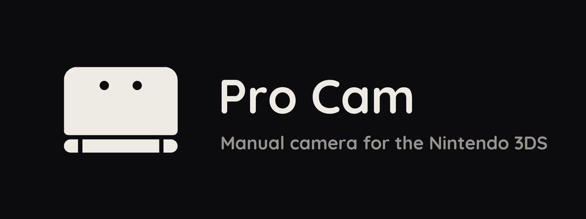
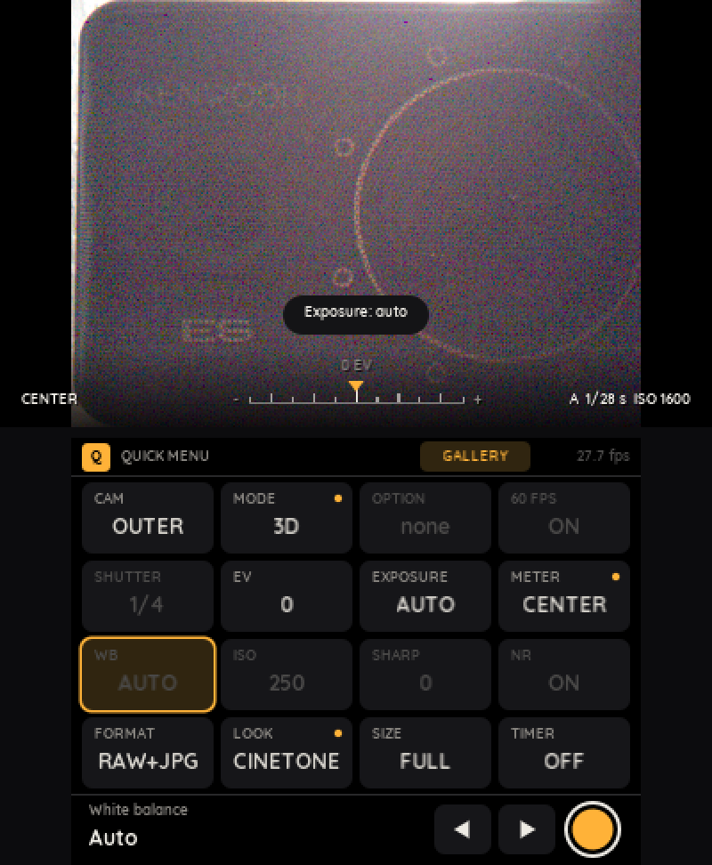
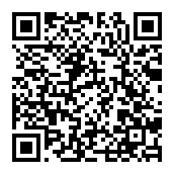
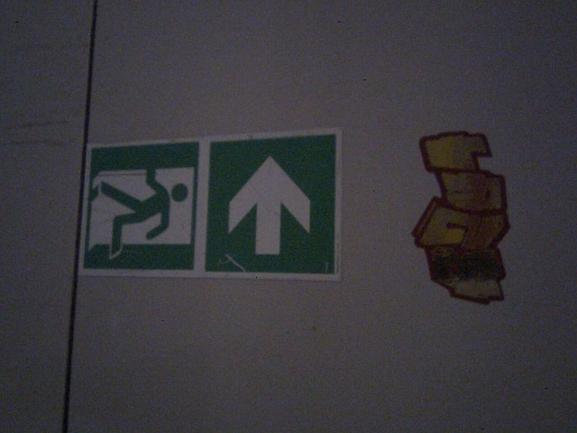
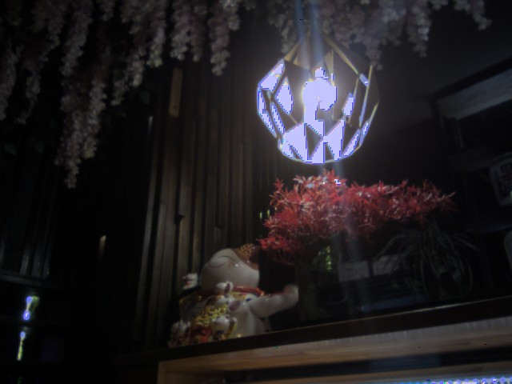
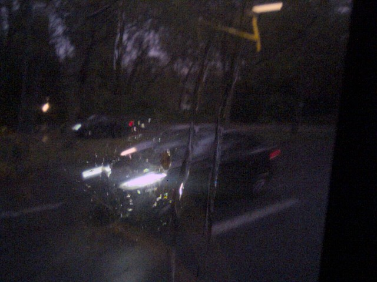
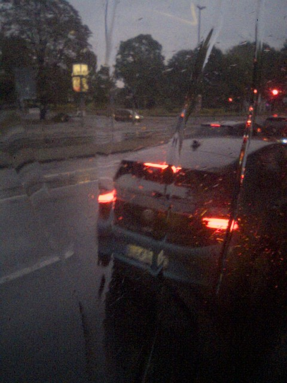
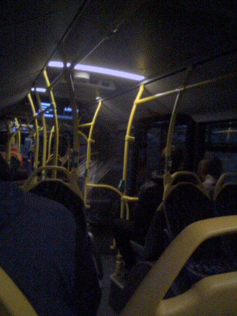

<p align="center"></p>

A 3DS camera app with manual controls and raw photos.

<p align="center">
  
</p>

## Install

You need a 3DS with [Luma3DS](https://github.com/LumaTeam/Luma3DS).

1. Open FBI.
2. Choose Remote Install, then Scan QR Code.
3. Scan this code.



Or download `procam.cia` from [Releases](https://github.com/3DS-Pro-Media-Suite/procam/releases/latest) and install it with FBI.
For the Homebrew Launcher, copy `procam.3dsx` to `sdmc:/3ds/`.

## Features

- Saves raw DNG, JPG, or both.
- Auto, shutter priority and manual exposure.
- Photo, Merge, HDR, 3D and Bracket modes.
- Histogram, framing grid, highlight and shadow warning, focus peaking.
- Colour looks for the JPG, editable in the app.
- FTP server and a darktable import plugin.

Raw photos, Merge, HDR and manual exposure need Luma3DS.

## Example photos

Taken with Pro Cam.

<p align="center">
  
  
  
</p>
<p align="center">
  
  
</p>

## Controls

| Button | Action |
|---|---|
| A, R or ZR | Take a photo |
| X, Y | Brighter, darker. In S and M, a longer or shorter exposure time |
| D-pad | Pick a setting |
| Circle Pad left, right | Change the picked setting |
| L | Lock or unlock the exposure |
| B | Change the information display |
| SELECT | Show the last photo |
| SELECT (hold) | Show all buttons |
| SELECT + L, or ZL | Swap the screens |
| START | Menu |
| START + SELECT | Quit |

Tap a setting on the touch screen, then tap it again to see all its values.
Tap GALLERY on the touch screen to see your photos.

## Files

| What | Where |
|---|---|
| Photos | `sdmc:/DCIM/procam` |
| Settings | `sdmc:/3ds/procam` |
| Looks | `sdmc:/3ds/procam/looks` |

FTP: open the gallery and press Y. It has no password, so use a trusted network.

## darktable

`tools/darktable` is a darktable plugin. It imports your photos over FTP and can delete them on the 3DS.

1. Install Python 3.
2. Add these lines to darktable's `luarc` file:
   ```lua
   package.path = package.path .. ";<path to procam>/tools/darktable/?.lua"
   require "procam_import"
   ```
3. Turn on FTP in Pro Cam.
4. In darktable's lighttable, open 3DS import.
5. Enter the 3DS's IP address and a photo folder, then click "import from 3DS".

## Build

You need devkitPro with `3ds-dev`, `3ds-zlib`, `3ds-libpng` and `3ds-libjpeg-turbo`.

```sh
git clone --recursive https://github.com/3DS-Pro-Media-Suite/procam
make        # procam.3dsx
make cia    # procam.cia, needs makerom and bannertool
```

The font and the icon live in `assets/`. Each folder has a script that rebuilds the file the app uses.

## License

MIT. The Quicksand font is under the SIL Open Font License. libjpeg-turbo and the other libraries are listed in `NOTICE`.
